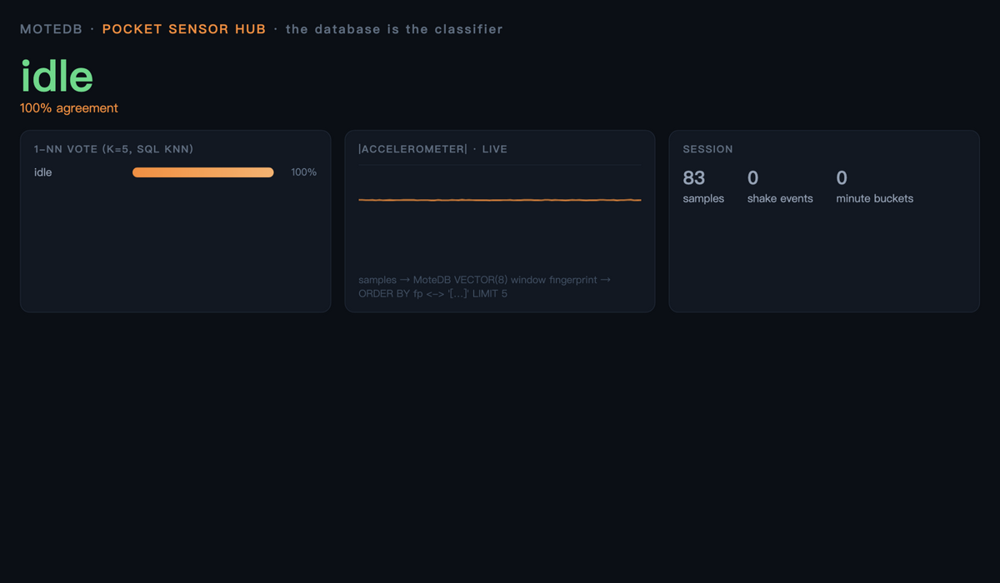
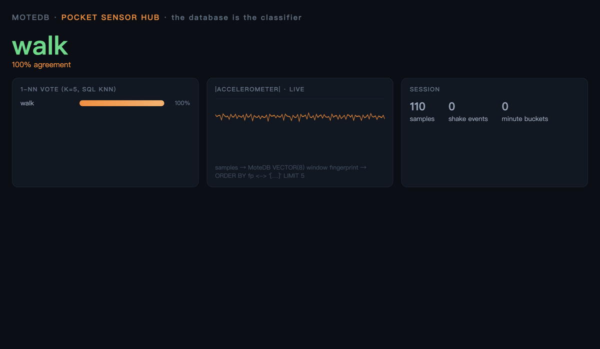

# Pocket Sensor Hub — your Android phone as an edge database node

A MoteDB demo that runs **on an Android phone** (via Termux) where **the
database IS the classifier**: you record a few gestures (their window
fingerprints land as `VECTOR(8)` rows), then MoteDB's SQL KNN recognizes
your activity live — with a web dashboard served from the phone.




*(idle → flat gravity line, walk ~2 Hz bounce — labeled live, 100% vote)*

```
Termux:API sensor stream (JSON, 5–50 Hz)
        │
        ▼
  sensor_hub ingest          ──►  sensor  (TIMESERIES + 2-day TTL)
        │                          minute_fp  (VECTOR(8) per minute)
        │                          events     (|acc| > 15 m/s² → shake)
        │                          minute_stats (continuous view)
        ▼
  sensor_hub report           ──► per-minute acc_power table in your terminal
  sensor_hub find-similar <ts> ─► KNN: "which earlier minute felt like this?"
  sensor_hub export <file>    ──► one .mote snapshot → adb pull → pandas
```

## On the phone (Termux)

1. Install [Termux](https://f-droid.org/en/packages/com.termux/) and the
   **Termux:API** companion app (both from F-Droid — the Play build is stale).
2. In Termux:

```bash
pkg update && pkg install rust git binutils termux-api
git clone https://github.com/motedb/motedb
cd motedb/demo/phone-sensor-hub

# 1. Teach it 3 gestures (~10 s each): put the phone on a desk, in your
#    pocket while walking, then shake it — one record call per gesture:
cargo run --release -- record idle  < <(termux-sensor -s 200 -d 0)   # Ctrl-C after ~10 s
cargo run --release -- record walk  < <(termux-sensor -s 200 -d 0)
cargo run --release -- record shake < <(termux-sensor -s 200 -d 0)

# 2. Live classification in the terminal:
cargo run --release -- live    < <(termux-sensor -s 200 -d 0)

# 3. …or with the web dashboard (open from any laptop on the same WiFi):
cargo run --release -- serve   < <(termux-sensor -s 200 -d 0)
#    → http://<phone-ip>:8080   (port via SENSOR_HUB_PORT)

# Batch import / analysis / snapshot still work as before:
cargo run --release -- ingest  < <(termux-sensor -s 200 -d 0)
cargo run --release -- report
cargo run --release -- export /sdcard/sensor.mote
```

`termux-sensor -s 200` streams accelerometer + gyroscope every 200 ms.

## Off-phone (macOS/Linux) — simulated data

```bash
python3 simulate.py > sim.jsonl       # 20 min: idle / walk / idle / shake / walk
cargo run --release -- ingest < sim.jsonl
cargo run --release -- report
# KNN sanity: the three activity types retrieve their own phases
cargo run --release -- find-similar $(( $(head -1 sim.jsonl | python3 -c \
  'import json,sys;print(json.loads(sys.stdin.readline())["timestamp"])') + 8*60*1000 ))
```

## What each piece demonstrates

| Piece | MoteDB capability |
|---|---|
| `sensor` table | `TIMESERIES(ts) TTL` — bounded retention on edge devices (TTL actually evicts: point the simulator's clock a few days back and the rows vanish) |
| `minute_stats` | `CREATE CONTINUOUS VIEW` + `TIME_BUCKET('1m')` — define once, query like a table |
| `minute_fp` | `VECTOR(8)` columns with string-literal inserts |
| `find-similar` | `ORDER BY fp <-> '[…]'` KNN over fingerprints |
| `record` → `live`/`serve` | **the database as a 1-NN classifier**: gesture fingerprints are the model, stored and queried as plain SQL VECTOR rows — no ML framework involved |
| `serve` dashboard | zero-dependency HTTP server (std only) + embedded vanilla-JS canvas page |
| `export` | single-file snapshot (CRC per file) — the transport step; open read-only anywhere with `Database::open_readonly` |
| build | `default-features = false` — no jemalloc/jieba/rayon, the smallest cross-target surface (Termux `aarch64-linux-android`) |

## Notes

- The demo depends on the **published crate** (`motedb` 0.18.x from
  crates.io), not the workspace — it is intentionally standalone.
- Fingerprints are quantile statistics of |acc| and gyro energy per minute —
  deliberately simple; swap in your own features and the KNN query stays
  identical.
